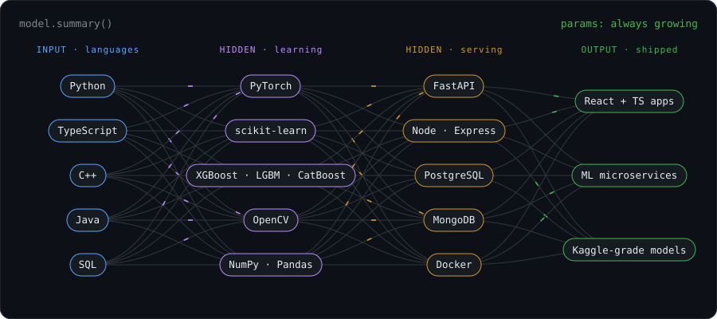
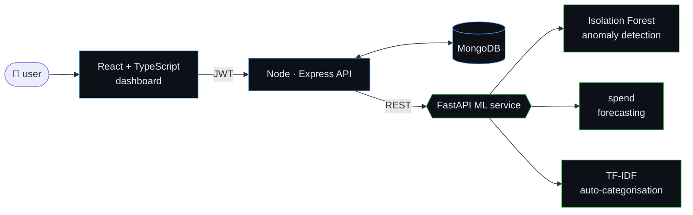

<!-- ─────────────────────────────────────────────────────────────
     varun.prajapati — a model that's still training
     every visual in this README is hand-built SVG in /assets
───────────────────────────────────────────────────────────── -->

<p align="center">
  
</p>

<p align="center">
  <a href="https://www.linkedin.com/in/vp916/"></a>
  <a href="mailto:vnp785@gmail.com"></a>
  
</p>

```python
class Varun(Engineer):
    loss_fn   = "the gap between a notebook and a shipped product"
    optimizer = "read the paper → break the baseline → ship the API"
    weights   = {"deep_learning": 0.45, "classical_ml": 0.25, "full_stack": 0.30}

    def forward(self, problem):
        model = self.train(problem, from_scratch=True)   # u-net++ dice 0.9796, no pretrained weights
        api   = FastAPI(model)                            # served as a microservice
        return React(api)                                 # …and someone actually clicks it
```

<br/>

## ⟢ `model.summary()`

<p align="center">
  
</p>

<br/>

## ⟢ `experiments/` — click a run to open the repo

<p align="center">
  <a href="https://github.com/vp916/chest-xray-disease-classification"></a>
  <a href="https://github.com/vp916/mechanical-parts-segmentation"></a>
  <a href="https://github.com/vp916/plant-leaf-super-resolution"></a>
  <a href="https://github.com/vp916/heavy_equipment_price_prediction"></a>
</p>

<br/>

## ⟢ `deploy/` — where the models meet users

**AI Transaction Analytics Platform** — a full ML product, not a notebook:



**AI Mental Health Support Platform** — journaling, self-assessments and an OpenAI-powered chat on React · Express · MongoDB with role-based access control.

<br/>

## ⟢ `git log --oneline --graph achievements`

```diff
+ * 3a91f2e  (HEAD → main)  🥉 2nd Runner-Up · Adani Innovation Mindstorm 2026
+ |                         built the Isolation Forest + LSTM pipeline for ICS anomaly detection
+ * 7c04d1b  🌱 Open Source Contributor · GirlScript Summer of Code 2026
+ |                         issues, features & PRs through reviewed GitHub workflows
+ * e52b8a0  🏁 Top 40 Finalist · Odoo × MSU FootPrints'25 Hackathon
+ * 1f6c3d9  🤝 Junior Training & Placement Coordinator · FTE, MSU Baroda
+ |                         bridging recruitment drives between students and recruiters
  * 0000000  init: hello, world
```

<br/>

<details>
<summary><b>⟢ <code>tensorboard --logdir=github</code></b> &nbsp;<sub>(click to expand stats)</sub></summary>
<br/>
<p align="center">
  
  
</p>
</details>

<br/>

<p align="center">
  <sub><code>early_stopping(patience=∞)</code> · open an issue, send a PR, or just say hi — the gradient's always open.</sub>
</p>
